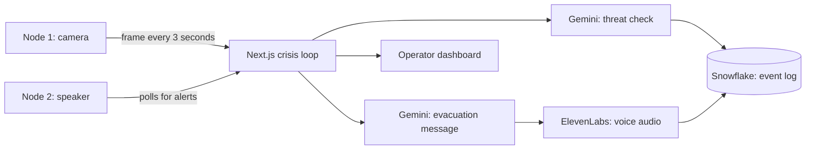

# Sentinel Node

A hackathon prototype that turns ordinary cameras into an emergency network. When it spots a threat, it logs the event and speaks evacuation instructions through the nearest node.

[](https://www.youtube.com/watch?v=GDGI76j2z4o)

[Watch the demo on YouTube](https://www.youtube.com/watch?v=GDGI76j2z4o)

## Why

In an emergency, people need to know where to go right away, and responders need to know what's happening. Most buildings already have cameras, but those cameras only record. Sentinel Node explores what happens when they can react.

## How it works



1. Each node captures a webcam frame and sends it to the server.
2. Gemini checks the frame for a gun, fire or earthquake.
3. A detected threat is logged in Snowflake.
4. Gemini writes an evacuation message based on the threat location and a list of safe zones.
5. ElevenLabs turns the message into speech, and the target node plays it aloud.
6. Operators follow the incident on a live dashboard.

## The hardware pivot

The original plan was a Raspberry Pi network with sensors. During the hackathon, networking problems and missing cables got in the way, so we dropped the Pi and ran the nodes on two laptops. The node script is a plain Python program, so it only needs a webcam and speakers.

## Tech stack

- **Dashboard and API:** Next.js, React, TypeScript, Tailwind CSS, Zustand, Auth0
- **AI:** Google Gemini, Google Cloud Vision, ElevenLabs
- **Data:** Snowflake
- **Edge nodes:** Python, OpenCV, pygame
- **Deployment:** Docker on Railway

## Run it locally

You need Node.js with pnpm, Python, and accounts for the services listed in `Dashboard/.env.example`.

**Dashboard**

```bash
cd Dashboard
pnpm install
pnpm dev
```

Copy `.env.example` to `.env.local` and fill in your keys first.

**Edge node**

```bash
cd Hardware
pip install -r requirements.txt
python node.py
```

Set `NODE_ID` (for example `NODE-001`) and `SENTINEL_SERVER_URL` before you start it. See the [hardware guide](Hardware/README.md) for details.

## Team

Built by Atinder Harika and Chahatbir Singh at a hackathon in April 2026. Chahatbir worked on the frontend. Much of the code was written with AI coding assistants, directed by the team.

## Limitations and what I'd do next

- This is a prototype, and it isn't safe for real emergencies.
- It's slow and resource-limited: nodes send a frame every 3 seconds, and each check waits on cloud AI calls.
- The demo used two laptops, not a real camera network.
- Evacuation messages come from a list of safe zones. Routing from a real floor plan is the biggest next step.
- It doesn't contact emergency services yet.
- False alarms and missed threats haven't been measured.
- The hackathon deployment is offline, so the video is the best way to see it.
